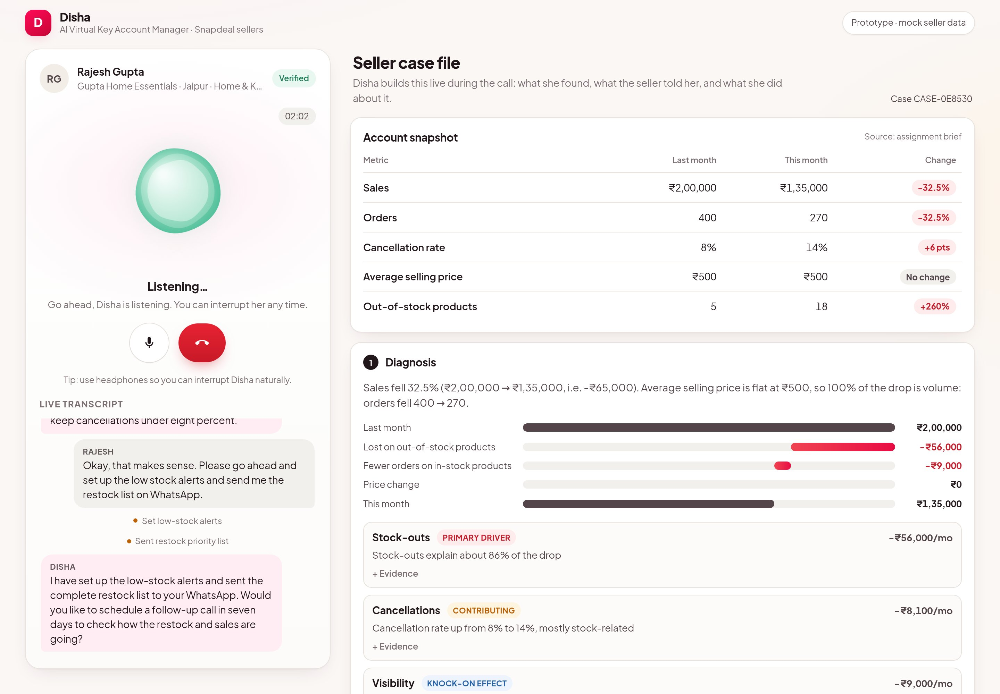
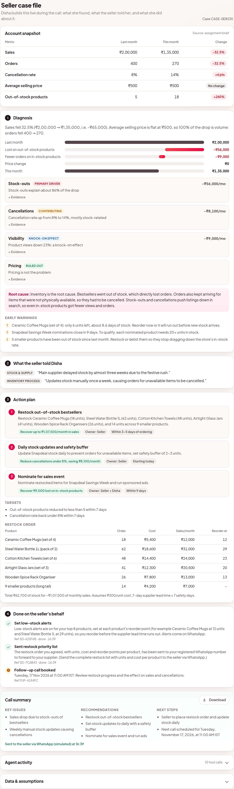
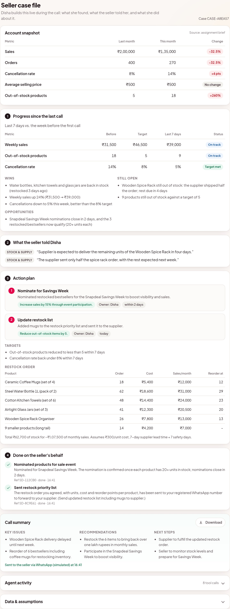
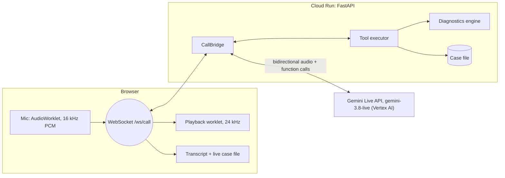
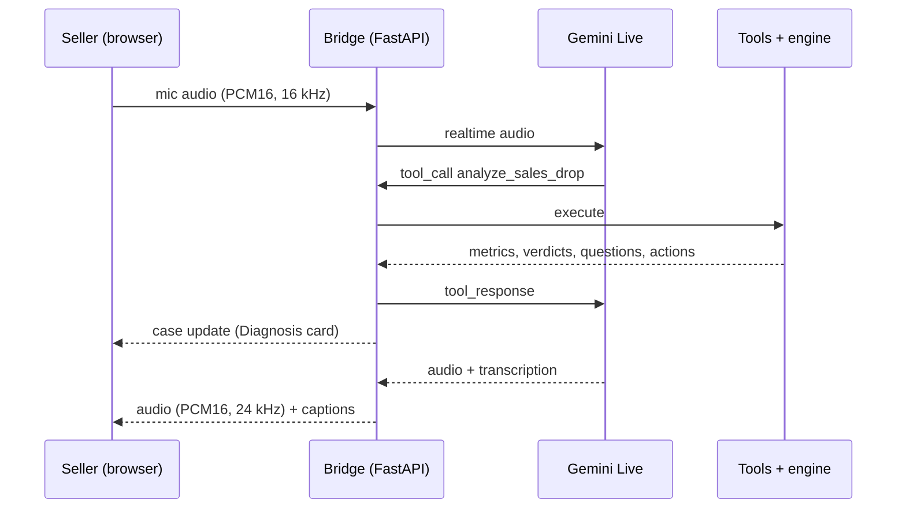

# Disha: an AI Virtual Key Account Manager for Snapdeal sellers

[](https://github.com/aashishraghav-dev/snapdeal-virtual-kam/actions/workflows/ci.yml)

A **voice-first AI agent** that takes ownership of a seller's problem. A seller says *"my sales dropped"*, and
Disha diagnoses the account, asks the right follow-up questions, turns the fix into a costed restock plan, **acts on
the seller's behalf** (with consent), and then **calls back a week later** to check the plan worked. All of it
happens in a natural, interruptible voice conversation in English or Hindi.

> **Live demo:** `<add URL>` (temporary) · **Recording:** `<add link>` · **One-page note:**
> [docs/SUBMISSION_NOTE.md](docs/SUBMISSION_NOTE.md) · **Design notes:** [docs/DESIGN.md](docs/DESIGN.md) ·
> **Evaluation report:** [evals/results/REPORT.md](evals/results/REPORT.md)



---

## What happens on a call

1. **Greets** the seller and finds out why they're calling. With *"Disha calls proactively"* selected, she
   places the call herself because monitoring flagged the drop.
2. **Diagnoses** with a deterministic analytics engine, not LLM arithmetic. The ₹65,000 (32.5%) drop is entirely
   volume, since the average selling price is flat. About 86% of it is explained by stock-outs. Cancellations and
   visibility are knock-on effects, and pricing is ruled out.
3. **Asks** 2–3 targeted follow-ups, one at a time (*Why did stock run out? How do you update stock on Snapdeal?*),
   and records the answers.
4. **Recommends** 2–3 prioritised actions with rupee impact, tailored to those answers. The restock advice is an
   actual purchase order: units, cost, the monthly sales it brings back, and reorder points that account for the
   supplier's lead time. If cash is tight, it fits a budget and splits the rest into phases.
5. **Flags what the seller didn't ask about**, e.g. *"your coffee mugs run out in about 9 days"* or *"sale
   nominations close soon"*.
6. **Owns the next step.** After the seller says yes, she sets low-stock alerts at the right reorder points, pauses
   listings that can't be fulfilled, sends the restock list on WhatsApp, nominates restocked bestsellers for a sale,
   and books a 7-day follow-up. Each action gets a reference ID.
7. **Summarises** the key issues, actions and next steps, sends the summary, and hangs up.
8. **Closes the loop.** Press *"Fast-forward 7 days"* and Disha makes the follow-up call. She reviews progress
   against the targets she set (wins first, then what's behind), raises new risks, and agrees the next actions.
   The week-later numbers are simulated, but driven by what was actually agreed on the first call.

<details>
<summary>The case file after a complete call (from the automated headless-Chrome test)</summary>


</details>

<details>
<summary>The 7-day follow-up call: progress against the targets Disha set</summary>


</details>

## How it meets the brief

| Brief requirement | Implementation |
|---|---|
| Greet and understand the reason for the call | Persona prompt plus inbound greeting; optional proactive outbound mode |
| Natural two-way voice conversation | Gemini Live native-audio speech-to-speech, server-side VAD, barge-in, **~2 s median response** |
| Relevant follow-up questions | The engine proposes data-driven questions; Disha asks one per turn and adapts |
| Use the sample data (pricing, inventory, cancellations, visibility) | Brief metrics used verbatim; all four hypotheses get an evidence-based verdict |
| Recommend 2–3 practical actions | Ranked actions with ₹ impact, tailored to the seller's answers; restocking comes as a costed purchase order with reorder points |
| Summarise issues, recommendations, next steps | Spoken summary, case-file card and downloadable Markdown |
| Voice-first, not a text chatbot | There is no text input at all; the transcript is only captions |

## Architecture





**Tools the agent can call**

| Tool | Purpose |
|---|---|
| `analyze_sales_drop` | Runs the diagnostics engine: sales bridge, verdict per hypothesis, rupee impact, early warnings, questions, ranked actions |
| `get_account_details(area)` | Drill-down: `stock`, `cancellations`, `visibility`, `pricing`, `opportunities` |
| `plan_restock(budget, lead_time)` | Purchase order: units, cost, monthly sales recovered, reorder points; budget-aware phasing |
| `review_progress` | Follow-up calls: KPIs vs. targets, wins, open items, new risks, opportunities |
| `record_seller_insight` | Saves what the seller said, so recommendations reflect it |
| `save_action_plan` | Commits 2–3 tailored actions plus measurable targets |
| `take_action` | Consent-gated, idempotent actions (alerts, pause listings, WhatsApp list, sale nomination, ads draft, ticket, human callback) |
| `schedule_follow_up` | Books a check-in only after the seller agrees (enforced); reschedules instead of double-booking |
| `end_call_with_summary` | Saves and "sends" the summary, then triggers a graceful hang-up |

## Key design decisions

1. **Speech-to-speech instead of STT → LLM → TTS.** A single model hop gives lower latency, natural prosody,
   barge-in and Hindi/Hinglish code-switching.
2. **The LLM handles conversation; code handles the math.** Every figure comes from the deterministic engine
   ([`diagnostics.py`](app/diagnostics.py), [`planning.py`](app/planning.py), [`progress.py`](app/progress.py)),
   and unit tests reconcile it with the brief, so the agent can't invent numbers.
3. **Ownership through guarded tools, and a closed loop.** Actions need an explicit consent flag. Repeated calls
   don't run twice, which matters when the model retries a call. Every step is written to an auditable activity log.
   The follow-up call then checks whether the plan worked.
4. **Model chosen by measurement.** I ran the same scripted voice conversation against `gemini-3.8-live` and
   `gemini-live-2.5-flash-native-audio`. 3.8 had roughly half the latency (median 1.8–2.1 s across runs vs ~4 s) and no
   duplicate tool calls, so it's the default. Switching back is one environment variable.
5. **The server sits in the middle.** Credentials never reach the browser, and tools run next to the data. The
   WebSocket only accepts connections from the app's own origin, and CSP, call-length and concurrency caps keep
   the public demo safe.

## The diagnosis on the sample data

| Driver | Verdict | Evidence | Impact / month |
|---|---|---|---|
| Stock-outs | **Primary driver** | Out-of-stock products 5 → 18 (30% of 60 listings); 4 of the top 8 bestsellers out for 12–20 days | ₹56,000 |
| Cancellations | Contributing | 8% → 14%; cancellations for unavailable items 9 → 24 (63% of all cancellations); realised sales −37% | ₹8,100 |
| Visibility | Knock-on effect | Product views −23%, conversion 2.0% → 1.75%, in-stock products lost 18 orders | ₹9,000 |
| Pricing | Ruled out | Average selling price flat at ₹500; within ±3% of competitors | ₹0 |

Sales bridge: ₹2,00,000 − ₹56,000 (stock-outs) − ₹9,000 (in-stock, visibility) ± ₹0 (price) = **₹1,35,000**.

**Assumptions.** The brief's five metrics are used exactly. Everything else is a labelled assumption that adds up
to the brief's totals, and [tests](tests/test_diagnostics.py) enforce this:

- A fictional seller, Gupta Home Essentials (Jaipur).
- SKU-level orders and stock for the top 8 products, plus an aggregated long tail.
- Cancellation reasons and product views.
- A competitor price index.
- A fictional upcoming sale.

Sales and orders are treated as gross, before cancellations. The full list is in the app under *Data &
assumptions*.

## How quality is measured

| Layer | What it shows |
|---|---|
| **Conversation evals** ([report](evals/results/REPORT.md)) | 10 simulated seller personas run full calls against the production agent, and an LLM judge scores 8 criteria against the account's ground truth. Final: **4.72 / 5** averaged over 2 independent runs per persona; hard checks passed in 19 of 20 calls. |
| Unit tests (`tests/`) | 78 tests: analytics reconcile with the brief; planner and follow-up math; tool validation, consent and idempotency; the WebSocket bridge with a fake Live session |
| Voice E2E (`scripts/e2e_voice_test.py`) | Full calls with synthesised seller **speech** through the real audio path: ~2 s median response, Disha hangs up on her own |
| Browser E2E (`scripts/browser_e2e.py`) | The real UI in headless Chrome with a synthetic microphone, including "Fast-forward 7 days" |

**Evaluation history.** Single runs turned out to be noisy: near-identical prompts scored 4.88 and 4.54. So the
final rounds average two independent runs per persona.

| Round | Change | Avg / 5 |
|---|---|---|
| 1 | Baseline | 4.41 |
| 2 | Fixed number leakage, the human-request rule, consent, and "tools first, then speak" | 4.88 (1 run) |
| 3 | Budget question, unambiguous restock phrasing | 4.54 (1 run) |
| 4 | Language rule, the human callback no longer pushes the analysis, follow-up next steps | 4.59 (2 runs) |
| 5 | Plan, actions and summary must match what was said; judge rubric clarified | **4.72** (2 runs) |

**What the evals caught (and how each was fixed)**

| Failure found | Fix |
|---|---|
| The system prompt contained the brief's numbers, so in Hindi Disha answered **without calling the diagnosis tool** | Removed every figure from the prompt; numbers can only come from tools |
| Ignored a seller's first request for a human and started the diagnosis | A rule to handle "I want a human" first: offer the callback, act on yes |
| Promised to raise a courier ticket, then never did | "Never promise an action you don't take"; the eval checks for the ticket |
| Booked the follow-up before the seller agreed | `schedule_follow_up` now *requires* `seller_agreed=true`, enforced in code |
| Repeated sentences when speaking between tool calls | "Tools first, then speak once" turn discipline |
| "Order 18 more" heard as "18 left" | The planner returns `order_units` and `on_hand` separately, with unambiguous spoken phrasing |

The headless-browser test caught one more: `gemini-3.8-live` streams audio in real time, so a pause mid-turn looked
like the end of Disha's turn and the seller could talk over her. The UI now keeps the turn open until the server
sends `turn_complete`.

## Run locally

Prerequisites:

- Python 3.12+.
- Either a Google Cloud project with the Vertex AI API enabled (run `gcloud auth application-default login`), or a
  Gemini API key.

```bash
git clone https://github.com/aashishraghav-dev/snapdeal-virtual-kam.git && cd snapdeal-virtual-kam
python3 -m venv .venv && .venv/bin/pip install -r requirements-dev.txt
cp .env.example .env        # set GOOGLE_CLOUD_PROJECT (or GEMINI_API_KEY + a matching LIVE_MODEL)
./scripts/run_local.sh      # http://localhost:8080
```

Open the page in Chrome, Edge or Safari and allow microphone access. Headphones give the most natural barge-in.

## Tests and evaluations

```bash
make test     # unit tests: analytics vs. brief, planner, follow-up, tools, HTTP + WebSocket bridge (fake Live session)
make lint     # ruff
make e2e      # full voice call against a running server using synthesised seller speech: transcript, tools, latency
make evals    # 10 simulated-seller conversations + LLM judge -> evals/results/REPORT.md (needs Vertex AI access)
.venv/bin/python scripts/browser_e2e.py --url http://localhost:8080 --followup   # real UI in headless Chrome (pip install playwright)
```

## Deploy to Cloud Run, then tear down

```bash
PROJECT_ID=<your-project> ./scripts/deploy.sh   # build with Cloud Build, deploy, print the public URL
./scripts/teardown.sh                            # delete exactly what deploy.sh created (asks for confirmation)
```

`deploy.sh` records every resource it creates in `.deploy/state.env`:

- the Cloud Run service
- a dedicated Artifact Registry repo
- a runtime service account with `roles/aiplatform.user`
- the staged Cloud Build source
- any APIs it had to enable

`teardown.sh` removes only those resources, so anything that existed before is left alone.

<details>
<summary>Manual teardown (if <code>.deploy/state.env</code> is lost)</summary>

```bash
P=<project>; R=us-central1
gcloud run services delete snapdeal-virtual-kam --region $R --project $P --quiet
gcloud projects remove-iam-policy-binding $P --member serviceAccount:vkam-run@$P.iam.gserviceaccount.com --role roles/aiplatform.user --condition None
gcloud iam service-accounts delete vkam-run@$P.iam.gserviceaccount.com --project $P --quiet
gcloud artifacts repositories delete snapdeal-virtual-kam --location $R --project $P --quiet
gcloud storage rm --recursive gs://${P}_cloudbuild/snapdeal-virtual-kam-source/
```
</details>

## Project structure

```text
app/
  main.py            FastAPI app: static UI, /healthz, /api/config, /ws/call, security headers
  live_session.py    Browser WebSocket <-> Gemini Live bridge (audio, transcripts, tool calls, hang-up)
  prompts.py         Persona, call flow per mode, tricky-moment playbook, voice style, grounding rules
  tools.py           Function declarations + executor (validation, consent, idempotency)
  diagnostics.py     Deterministic analytics: decomposition, attribution, verdicts, early warnings, actions
  planning.py        Restock planner: order quantities, cost, reorder points, budget phasing
  progress.py        7-day follow-up: progress simulation driven by what was agreed
  seller_data.py     Brief metrics (verbatim) + labelled assumptions
  case_file.py       Per-call state mirrored to the UI
static/              Vanilla HTML/CSS/JS UI, AudioWorklets, audio-reactive orb
evals/               Simulated-seller scenarios, judge, and the latest report + transcripts
tests/               Unit tests (pytest)
scripts/             deploy.sh, teardown.sh, run_local.sh, e2e_voice_test.py, browser_e2e.py
docs/                Submission note, design notes, demo script, screenshots
```

## Security and privacy

- No secrets in code. Vertex AI is reached through the Cloud Run service account (least privilege). `.env` is
  git-ignored.
- The WebSocket rejects connections from other sites (cross-site hijacking protection). There's a strict CSP, and
  model or user text is never inserted as HTML.
- Public-demo caps: 10-minute calls, 6 concurrent calls per instance, at most 3 instances.
- Audio is never stored or logged; only call metadata is (duration, tools used, token count). The seller data is
  entirely mock data.

## What I'd build next

- **Telephony:** put the same bridge behind a phone number (Exotel, Twilio or SIP media streams) for sellers who
  prefer to call.
- **Real integrations:** swap `seller_data.py` for Seller Panel APIs, and make actions real API calls with the same
  consent and idempotency contract.
- **Memory and outcomes:** persist case files so the follow-up call starts where the last one ended and measures
  results (did stock-outs drop back to 5 or fewer?).
- **Proactive triggers:** a scheduled anomaly-detection job that starts outbound calls or WhatsApp nudges.
- **Evals at scale:** run the persona suite on every prompt change (as a CI gate), add audio-input personas
  with accents and background noise, and extend to Tamil, Telugu and Bengali.
